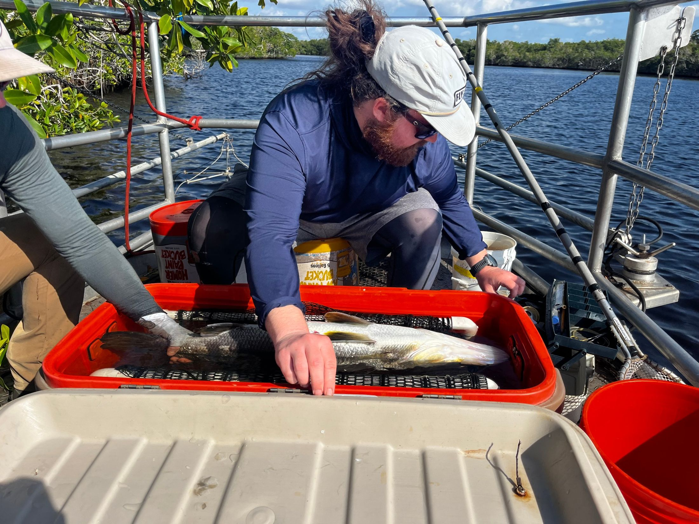
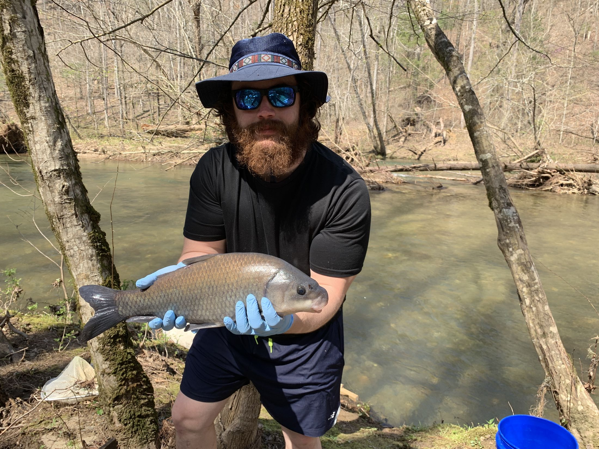
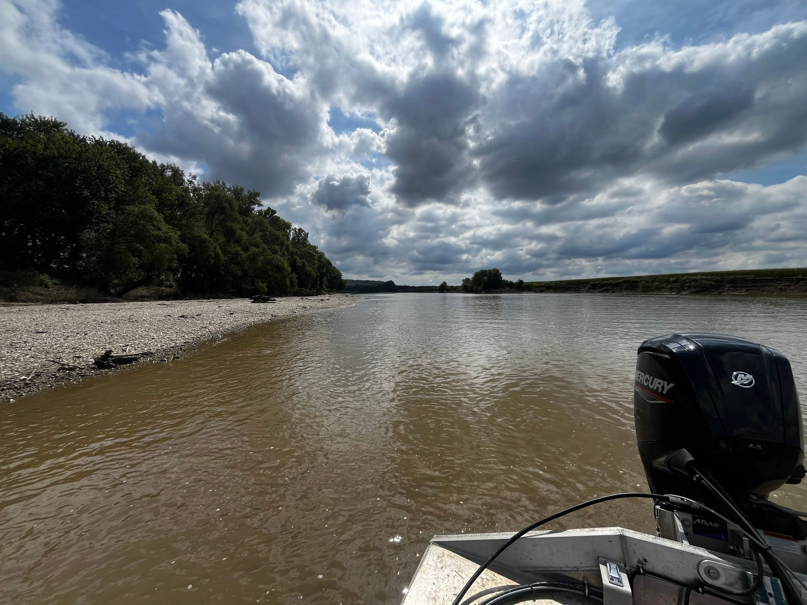

```{=html}
<script>document.body.classList.add('mw-rpage');</script>
<link rel="stylesheet" href="https://cdnjs.cloudflare.com/ajax/libs/leaflet/1.9.4/leaflet.min.css">
<script src="https://cdnjs.cloudflare.com/ajax/libs/leaflet/1.9.4/leaflet.min.js"></script>

<!-- ============ INTRO ============ -->
<header class="rs-intro">
  <h1 class="rs-title">Research</h1>
  <p class="rs-lede">From Appalachian creeks to coral reefs, I study how animals move, feed, and recycle nutrients, and how global change is reshaping all three. Explore where the work happens, then read what we found.</p>
</header>

<!-- ============ MAP ============ -->
<!-- Sites are listed in the SITES array in the script at the bottom of this page.
     To add a site: copy one entry, change lat/lng, name, theme, text and papers. -->
<section class="rs-map-wrap" aria-label="Map of study sites">
  <div id="rs-map" role="region" aria-label="Interactive map of study sites"></div>
  <div class="rs-map-ui">
    <div class="rs-regions" role="group" aria-label="Zoom to a region">
      <button type="button" data-region="all" aria-pressed="true">All U.S. sites</button>
      <button type="button" data-region="appalachia">Appalachia</button>
      <button type="button" data-region="everglades">Everglades</button>
      <button type="button" data-region="crb">Colorado River basin</button>
      <button type="button" data-region="ohio">Ohio River basin</button>
      <button type="button" data-region="synthesis">Synthesis network</button>
    </div>
  </div>
  <ul class="rs-legend" aria-label="Map legend">
    <li><span class="dot" style="--c: var(--rs-move)"></span>Animal movement</li>
    <li><span class="dot" style="--c: var(--rs-nutr)"></span>Nutrients and food webs</li>
    <li><span class="dot" style="--c: var(--rs-river)"></span>Rivers under global change</li>
    <li><span class="dot" style="--c: var(--rs-syn)"></span>Synthesis sites</li>
  </ul>
  <noscript><p class="rs-pad">The interactive map needs JavaScript. Study sites are described in each section below.</p></noscript>
</section>
<p class="rs-map-note">Pin locations are approximate. Select a pin to see the question and papers behind it.</p>

<!-- ============ THEMES ============ -->
<section class="rs-theme" id="movement">
  <figure class="rs-theme-photo">
    
    <figcaption>Acoustic tagging surgery on a Common Snook in Tarpon Bay, Everglades National Park</figcaption>
  </figure>
  <div class="rs-theme-text">
    <p class="rs-kicker" style="--c: var(--rs-move)">Animal movement</p>
    <h2>When, where, and why do animals move?</h2>
    <p>Using acoustic telemetry, accelerometers, and long-term tracking, I follow individual predators through the coastal Everglades to learn how temperature, water levels, and body size shape what they do.</p>
    <ul class="rs-findings">
      <li>Common Snook activity dropped sharply above 26&nbsp;°C, and fish switched between day and night activity at temperature extremes.
        <a href="https://doi.org/10.1098/rsos.260735">White et al. 2026, <i>Royal Society Open Science</i></a></li>
      <li>In wetter years, individual snook specialized more in where they spent their time, and specialists ate a narrower range of prey.
        <a href="https://doi.org/10.1038/s41598-024-82158-4">Santos et al. 2025, <i>Scientific Reports</i></a></li>
      <li>Most snook that left the Shark River did so in spawning season, and about half came back, showing one river is only part of their range.
        <a href="https://doi.org/10.1093/mcfafs/vtaf050">Goldner et al. 2026, <i>Marine and Coastal Fisheries</i></a></li>
      <li>Spotted Seatrout in Florida Bay choose habitat at two scales at once: the seagrass patch and the wider seascape.
        <a href="https://doi.org/10.1038/s41598-025-27322-0">Rodemann et al. 2025, <i>Scientific Reports</i></a></li>
    </ul>
  </div>
</section>

<section class="rs-theme rs-flip" id="nutrients">
  <figure class="rs-theme-photo">
    
    <figcaption>Migrant Smallmouth Buffalo sampled from Citico Creek, Cherokee National Forest</figcaption>
  </figure>
  <div class="rs-theme-text">
    <p class="rs-kicker" style="--c: var(--rs-nutr)">Nutrients and food webs</p>
    <h2>How do animals move nutrients and energy through ecosystems?</h2>
    <p>Fish recycle nutrients through excretion and carry them between habitats in their bodies and eggs. I measure those fluxes, from a single spawning run to decades of data across ocean ecosystems.</p>
    <ul class="rs-findings">
      <li>About 67,000 migrating Smallmouth Buffalo delivered an estimated 730&nbsp;kg of nitrogen and 80&nbsp;kg of phosphorus to Citico Creek in a single spawning season.
        <a href="https://doi.org/10.1111/eff.12676">White et al. 2023, <i>Ecology of Freshwater Fish</i></a></li>
      <li>Migrating redhorses delivered a spring pulse of nitrogen, mostly through their eggs, when the stream was exporting little nitrogen of its own.
        <a href="https://doi.org/10.1111/eff.12758">Hudson et al. 2024, <i>Ecology of Freshwater Fish</i></a></li>
      <li>Across ~25 years and ~1.5 million fishes in coral reefs, mangroves, seagrass beds, and kelp forests, richer fish communities supplied nitrogen more steadily.
        <a href="https://doi.org/10.1073/pnas.2532469123">White et al. 2026, <i>PNAS</i></a></li>
      <li>In warmer water, snook ate fewer fish and more often had empty stomachs, meaning they must eat more low-quality prey to meet their energy needs.
        <a href="https://doi.org/10.1093/mcfafs/vtaf031">White et al. 2025, <i>Marine and Coastal Fisheries</i></a></li>
    </ul>
  </div>
</section>

<section class="rs-theme" id="rivers">
  <figure class="rs-theme-photo">
    
    <figcaption>Lunch break on the Scioto River, OH</figcaption>
  </figure>
  <div class="rs-theme-text">
    <p class="rs-kicker" style="--c: var(--rs-river)">Rivers under global change</p>
    <h2>How do flow loss, warming, and invasions reshape river communities?</h2>
    <p>Rivers in the Colorado River basin are drying as demand for water grows, and Ohio's rivers face invasive carp and changing land use. I study what these pressures mean for native fishes and aquatic insects.</p>
    <ul class="rs-findings">
      <li>Across seven Colorado River basin rivers, aquatic insect communities were less diverse where flows have declined the most.
        <span class="rs-status">White et al., in review, <i>Ecohydrology</i></span></li>
      <li>In the White River, Utah, long considered a refuge, native fish densities declined from 2008 to 2025 while nonnative fishes stayed abundant.
        <span class="rs-status">Porter et al., in review, <i>Biological Conservation</i></span></li>
    </ul>
  </div>
</section>

<!-- ============ WHAT'S NEXT ============ -->
<section class="rs-next" aria-labelledby="next-h">
  <h2 id="next-h" class="rs-h2">What's next</h2>
  <ol>
    <li><span class="rs-tag">Funded</span><span><strong>Paddlefish on the move.</strong> Tracking American Paddlefish through the Scioto and Ohio Rivers, with support from the Columbus Zoo and Aquarium.</span></li>
    <li><span class="rs-tag">In prep</span><span><strong>Where invasive carp stay.</strong> How Silver Carp residency varies across the Ohio River and its major tributaries.</span></li>
    <li><span class="rs-tag">In prep</span><span><strong>Land use versus flow.</strong> Whether fish, insect, and mussel life histories across Ohio respond more to land use or to hydrology.</span></li>
    <li><span class="rs-tag">In prep</span><span><strong>Movement and nutrient flux.</strong> How individual movement strategies shape where consumers deposit nutrients and energy.</span></li>
    <li><span class="rs-tag">Presented</span><span><strong>Why Y?</strong> Evaluating genetic biocontrol for invasive Channel Catfish in the San Juan River basin.</span></li>
  </ol>
</section>

<!-- ============ OPEN SCIENCE + SUPPORT ============ -->
<section class="rs-open">
  <div>
    <h2 class="rs-h3">Open data and code</h2>
    <p>Datasets I've published through the Environmental Data Initiative:</p>
    <ul>
      <li>Nitrogen and phosphorus excretion rates of individual marine and estuarine animals (2025)</li>
      <li>Seasonal electrofishing data from Rookery Branch and Tarpon Bay, Everglades National Park, 2004 to present (2025)</li>
      <li>Movements of aquatic predators in the Shark River estuary, Everglades National Park, 2007 to present (2025)</li>
    </ul>
    <p class="rs-links"><a href="https://github.com/mackwhite">Code on GitHub</a> <a href="https://mackwhite.github.io/aquatic-ecology-osu/">Aquatic Ecology course site</a> <a href="CV.html#publications">All publications</a></p>
  </div>
  <div>
    <h2 class="rs-h3">Supported by</h2>
    <p>National Center for Ecological Analysis &amp; Synthesis and the U.S. Long-Term Ecological Research Network, Columbus Zoo and Aquarium, the Everglades Foundation, Florida Forage Fish Coalition, NSF CREST Center for Aquatic Chemistry &amp; Environment, and Tennessee Technological University.</p>
  </div>
</section>

<script>
(function () {
  if (!window.L) { document.getElementById('rs-map').innerHTML = '<p class="rs-pad">The map could not load. Study sites are described in each section below.</p>'; return; }

  var COLORS = { move: '#2B8FA8', nutr: '#5E8A2E', river: '#B5651D', syn: '#6B5B95' };
  var THEME_NAME = { move: 'Animal movement', nutr: 'Nutrients and food webs', river: 'Rivers under global change', syn: 'Synthesis site' };
  var DOI = {
    rsos: ['White et al. 2026, Royal Society Open Science', 'https://doi.org/10.1098/rsos.260735'],
    santos: ['Santos et al. 2025, Scientific Reports', 'https://doi.org/10.1038/s41598-024-82158-4'],
    goldner: ['Goldner et al. 2026, Marine and Coastal Fisheries', 'https://doi.org/10.1093/mcfafs/vtaf050'],
    diet: ['White et al. 2025, Marine and Coastal Fisheries', 'https://doi.org/10.1093/mcfafs/vtaf031'],
    sturges: ['Sturges et al. 2026, PLoS One', 'https://doi.org/10.1371/journal.pone.0336521'],
    rodemann: ['Rodemann et al. 2025, Scientific Reports', 'https://doi.org/10.1038/s41598-025-27322-0'],
    buffalo: ['White et al. 2023, Ecology of Freshwater Fish', 'https://doi.org/10.1111/eff.12676'],
    redhorse: ['Hudson et al. 2024, Ecology of Freshwater Fish', 'https://doi.org/10.1111/eff.12758'],
    pnas: ['White et al. 2026, PNAS', 'https://doi.org/10.1073/pnas.2532469123'],
    insects: ['White et al., in review, Ecohydrology', null],
    whiteriver: ['Porter et al., in review, Biological Conservation', null],
    carp: ['Holupka et al., in prep', null],
    lifehist: ['White et al., in prep', null]
  };
  var INSECTS = 'Aquatic insect communities across a gradient of chronic flow reduction.';
  var SITES = [
    { name: 'Shark River and Tarpon Bay', place: 'Everglades National Park, FL', lat: 25.40, lng: -80.99, theme: 'move', region: 'everglades',
      text: 'Long-term acoustic tracking and diet sampling of Common Snook, plus food web and fish community monitoring with the Florida Coastal Everglades LTER.',
      papers: ['rsos', 'santos', 'goldner', 'diet', 'sturges', 'pnas'] },
    { name: 'Florida Bay', place: 'Everglades National Park, FL', lat: 25.03, lng: -80.72, theme: 'move', region: 'everglades',
      text: 'Multi-scale habitat selection of Spotted Seatrout across a patchy seagrass seascape.',
      papers: ['rodemann'] },
    { name: 'Southwest Florida telemetry arrays', place: 'Southwest Florida coast', lat: 25.95, lng: -81.72, theme: 'move', region: 'everglades',
      text: 'Partner acoustic arrays that detected snook after they left the Shark River.',
      papers: ['goldner'] },
    { name: 'Taylor Slough', place: 'Everglades National Park, FL', lat: 25.33, lng: -80.62, theme: 'nutr', region: 'everglades',
      text: 'How much food webs rely on algae ("green") versus detritus ("brown") energy from marsh to seagrass.',
      papers: ['sturges'] },
    { name: 'Citico Creek', place: 'Cherokee National Forest, TN', lat: 35.50, lng: -84.10, theme: 'nutr', region: 'appalachia',
      text: 'Nitrogen and phosphorus delivered by spawning migrations of Smallmouth Buffalo.',
      papers: ['buffalo'] },
    { name: 'Brasstown Creek', place: 'Hiwassee River basin', lat: 35.03, lng: -83.95, theme: 'nutr', region: 'appalachia',
      text: 'Nutrient subsidies from migrating redhorse suckers through excretion and eggs.',
      papers: ['redhorse'] },
    { name: 'White River', place: 'Utah', lat: 40.05, lng: -109.55, theme: 'river', region: 'crb',
      text: 'Native fish declines in a long-standing refuge, plus aquatic insects. ' + INSECTS,
      papers: ['whiteriver', 'insects'] },
    { name: 'Yampa River', place: 'Colorado', lat: 40.45, lng: -108.55, theme: 'river', region: 'crb', text: INSECTS, papers: ['insects'] },
    { name: 'Animas River', place: 'New Mexico', lat: 36.75, lng: -108.15, theme: 'river', region: 'crb', text: INSECTS, papers: ['insects'] },
    { name: 'Gunnison River', place: 'Colorado', lat: 38.98, lng: -108.45, theme: 'river', region: 'crb', text: INSECTS, papers: ['insects'] },
    { name: 'San Juan River', place: 'Utah', lat: 37.20, lng: -109.65, theme: 'river', region: 'crb',
      text: INSECTS + ' Also evaluating genetic biocontrol for invasive Channel Catfish.', papers: ['insects'] },
    { name: 'Price River', place: 'Utah', lat: 39.27, lng: -110.35, theme: 'river', region: 'crb', text: INSECTS, papers: ['insects'] },
    { name: 'San Rafael River', place: 'Utah', lat: 38.88, lng: -110.38, theme: 'river', region: 'crb',
      text: INSECTS + ' Sampled above and below a water diversion.', papers: ['insects'] },
    { name: 'Scioto River', place: 'Ohio', lat: 39.55, lng: -82.95, theme: 'river', region: 'ohio',
      text: 'Telemetry of American Paddlefish (funded by the Columbus Zoo and Aquarium) and sampling of Blue Sucker and other big-river fishes.', papers: [] },
    { name: 'Ohio River', place: 'Ohio River mainstem', lat: 38.73, lng: -82.98, theme: 'river', region: 'ohio',
      text: 'Residency of invasive Silver Carp across the Ohio River and its major tributaries.', papers: ['carp'] },
    { name: 'Ohio streams and rivers', place: 'Statewide, Ohio', lat: 40.30, lng: -82.75, theme: 'river', region: 'ohio',
      text: 'Whether fish, insect, and mussel life histories respond more to land use or hydrology, using Ohio EPA data from 1990 to 2025.', papers: ['lifehist'] },
    { name: 'Moorea Coral Reef LTER', place: 'Moorea, French Polynesia', lat: -17.53, lng: -149.83, theme: 'syn', region: 'synthesis',
      text: 'Coral reef fish communities in the consumer nutrient dynamics synthesis.', papers: ['pnas'] },
    { name: 'Santa Barbara Coastal LTER', place: 'Santa Barbara Channel, CA', lat: 34.40, lng: -119.75, theme: 'syn', region: 'synthesis',
      text: 'Kelp forest reef fish communities in the consumer nutrient dynamics synthesis.', papers: ['pnas'] },
    { name: 'PISCO, central California', place: 'Central California coast', lat: 36.60, lng: -121.95, theme: 'syn', region: 'synthesis',
      text: 'Kelp forest reef fish communities in the consumer nutrient dynamics synthesis.', papers: ['pnas'] },
    { name: 'PISCO, southern California', place: 'Southern California coast', lat: 33.40, lng: -118.40, theme: 'syn', region: 'synthesis',
      text: 'Kelp forest reef fish communities in the consumer nutrient dynamics synthesis.', papers: ['pnas'] },
    { name: 'Virginia Coast Reserve LTER', place: "Virginia's Eastern Shore", lat: 37.35, lng: -75.80, theme: 'syn', region: 'synthesis',
      text: 'Seagrass and sand flat fish communities in the consumer nutrient dynamics synthesis.', papers: ['pnas'] }
  ];

  var map = L.map('rs-map', { scrollWheelZoom: false, worldCopyJump: true, zoomSnap: 0.25 });
  // Free OpenStreetMap tiles (no API key). Muted to match the site with a CSS filter in styles.css.
  L.tileLayer('https://tile.openstreetmap.org/{z}/{x}/{y}.png', {
    attribution: '&copy; <a href="https://www.openstreetmap.org/copyright">OpenStreetMap</a> contributors', maxZoom: 12
  }).addTo(map);

  function esc(s) { var d = document.createElement('div'); d.textContent = s; return d.innerHTML; }
  var byRegion = {};
  SITES.forEach(function (s) {
    var html = '<div class="rs-pop"><p class="rs-pop-theme" style="--c:' + COLORS[s.theme] + '">' + THEME_NAME[s.theme] + '</p>' +
      '<h3>' + esc(s.name) + '</h3><p class="rs-pop-place">' + esc(s.place) + '</p><p>' + esc(s.text) + '</p>';
    if (s.papers.length) {
      html += '<ul>' + s.papers.map(function (k) {
        var p = DOI[k]; return '<li>' + (p[1] ? '<a href="' + p[1] + '">' + esc(p[0]) + '</a>' : esc(p[0])) + '</li>';
      }).join('') + '</ul>';
    }
    html += '</div>';
    var m = L.circleMarker([s.lat, s.lng], { radius: 8, color: '#fff', weight: 2, fillColor: COLORS[s.theme], fillOpacity: 0.95 })
      .bindPopup(html, { maxWidth: 300, autoPanPaddingTopLeft: [20, 90], autoPanPaddingBottomRight: [20, 20] }).addTo(map);
    m.bindTooltip(s.name, { direction: 'top', offset: [0, -8] });
    (byRegion[s.region] = byRegion[s.region] || []).push([s.lat, s.lng]);
  });
  var VIEWS = {
    all: [[24.5, -122.5], [41.5, -75]],
    appalachia: [[34.7, -84.6], [35.8, -83.5]],
    everglades: [[24.85, -81.95], [26.15, -80.4]],
    crb: [[36.4, -111], [40.8, -107.8]],
    ohio: [[38.5, -84.9], [40.6, -81.6]],
    synthesis: [[-20, -152], [40, -74]]
  };
  function go(r) { map.flyToBounds(VIEWS[r], { padding: [30, 30], duration: 0.8 }); }
  map.fitBounds(VIEWS.all, { padding: [20, 20] });
  var btns = document.querySelectorAll('.rs-regions button');
  btns.forEach(function (b) {
    b.addEventListener('click', function () {
      btns.forEach(function (x) { x.setAttribute('aria-pressed', x === b ? 'true' : 'false'); });
      go(b.dataset.region);
    });
  });
  map.on('click', function () { map.scrollWheelZoom.enable(); });
})();
</script>
```
