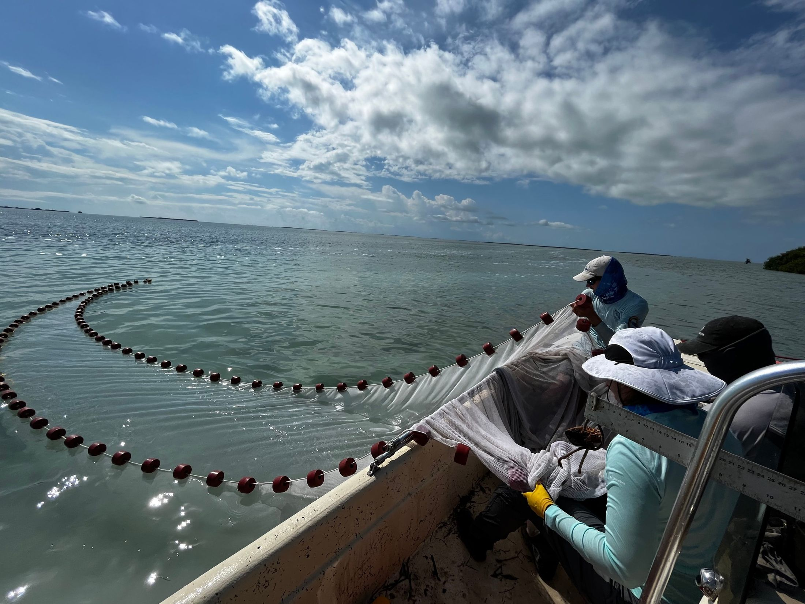
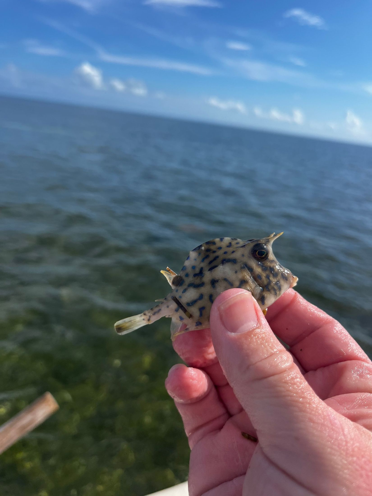

```{=html}
<!-- mw-rpage reuses the full-width layout from the Research page; mw-tpage holds teaching-only styles -->
<script>document.body.classList.add('mw-rpage', 'mw-tpage');</script>

<!-- ============ INTRO ============ -->
<header class="rs-intro">
  <h1 class="rs-title">Teaching</h1>
  <p class="rs-lede">My approach to teaching is rooted in helping students think critically and building excitement around learning. My goal is to give students the confidence and skills to succeed well beyond any one course or discipline.</p>
</header>

<figure class="tp-band">
  
  <figcaption>Retrieving a seine set from Florida Bay, Everglades National Park</figcaption>
</figure>

<!-- ============ EXPERIENCE ============ -->
<section class="tp-exp" aria-labelledby="exp-h">
  <h2 id="exp-h" class="rs-h2">In the classroom</h2>
  <div class="tp-exp-grid">
    <article class="tp-feature">
      <p class="tp-when">Instructor of record, The Ohio State University, Spring 2026</p>
      <h3>Aquatic Ecology <span>(EEOB 8896)</span></h3>
      <p>I designed this graduate course around a real research question. Students paired life-history traits with Ohio EPA monitoring data to ask how land use and hydrology shape fish, mussel, and aquatic insect communities across Ohio from 1990 to 2025. We're now finalizing the manuscript together for <i>Ecology Letters</i>.</p>
      <p><a href="https://mackwhite.github.io/aquatic-ecology-osu/">Visit the course website</a>, with code, readings, and resources I built for the class.</p>
    </article>
    <div class="tp-list">
      <h3 class="tp-sub">Teaching assistant</h3>
      <ul>
        <li><strong>Principles of Ecology Lab</strong> (BIOL 3130), Tennessee Tech, 2020–2021</li>
        <li><strong>Principles of Biology Lab</strong> (BIOL 1113), Tennessee Tech, 2019</li>
      </ul>
      <h3 class="tp-sub">Guest lectures</h3>
      <ul>
        <li>Ichthyology</li>
        <li>Methods in Field Ecology</li>
        <li>Fish Ecology</li>
      </ul>
      <h3 class="tp-sub">Workshops</h3>
      <ul>
        <li><strong>Storytelling with Science</strong>, for students, postdocs, and faculty in Florida and Ohio</li>
        <li><strong>Introduction to Git &amp; GitHub</strong>, The Ohio State University</li>
        <li><strong>Incorporating animal movement into ecosystem models</strong>, U.S. LTER All Scientists Meeting</li>
      </ul>
    </div>
  </div>
  <blockquote class="tp-quote">
    <p>Hearing about measuring fish excretion in the Cherokee National Forest or collecting detritus in Everglades mangrove creeks lets students see research as something people actually do, not an abstraction in a textbook. That makes a career in science feel within reach.</p>
  </blockquote>
  <p class="tp-note">During the COVID-19 pandemic, I helped rebuild Tennessee Tech's ecology labs for distanced learning. One favorite: students ran light–dark bottle experiments with water from a nearby stream or lake, which showed how light drives primary production, rewarded close observation, and got everyone outside at a time spent mostly indoors.</p>
</section>

<!-- ============ THREE SKILLS ============ -->
<section class="tp-skills" aria-labelledby="skills-h">
  <h2 id="skills-h" class="rs-h2">Three skills I teach in every course</h2>
  <p class="tp-skills-lede">These skills prepare students for careers in the natural sciences, and for being informed, engaged members of society whatever they go on to do.</p>
  <div class="tp-skill-grid">
    <article class="tp-skill">
      
      <h3>Working as a team</h3>
      <p>Science is a team sport, and collaboration is one of the skills employers value most. I teach it through short in-class activities, discussions about what makes team science work (drawing on my synthesis working groups at the National Center for Ecological Analysis &amp; Synthesis), and above all in the field, where students learn electrofishing, PIT-tagging, seining, and fish identification together.</p>
    </article>
    <article class="tp-skill">
      
      <h3>Working with data</h3>
      <p>Nearly every profession asks people to make, or at least interpret, data-driven decisions. I want students to know why they'd choose one method over another (ordinary least squares versus a generalized linear model, say) and how to read the results. That matters more than ever with AI: data analysis is more than equations hidden behind R or Python. Whenever I can, students analyze data they collected themselves.</p>
    </article>
    <article class="tp-skill">
      
      <h3>Communicating science</h3>
      <p>Clear, compelling writing is how research reaches science and society. I give students concrete tools that transformed my own writing, like the Baby–Werewolf–Silver Bullet framework and sentence and paragraph arcs. My <strong>Storytelling with Science</strong> workshop grew out of this, and I've helped undergraduate and graduate students at FIU and Ohio State publish their own research.</p>
    </article>
  </div>
</section>

<!-- ============ MENTORING ============ -->
<section class="tp-mentor" aria-labelledby="mentor-h">
  <div class="tp-mentor-text">
    <h2 id="mentor-h" class="rs-h2">Mentoring</h2>
    <p class="tp-mentor-lede">Mentoring is one of the most fulfilling parts of my job. Since 2020, I've mentored 3 graduate students at Ohio State, 18 undergraduates at FIU and Tennessee Tech, and 2 NSF REU students. Three habits guide how I work with them.</p>
    <dl class="tp-habits">
      <dt>Clear goals, realistic deadlines</dt>
      <dd>"Realistic" looks different for every student. A master's student who already has a first-author paper will move faster than one writing their first. I aim high either way, because even a missed deadline usually leaves a student close to a finished product and well on the way to a thesis chapter.</dd>
      <dt>Regular one-on-ones, on the student's schedule</dt>
      <dd>Students can spend weeks stuck on a problem that takes minutes to solve with someone more experienced; I've been on both sides of that table. Some students like weekly check-ins, others once a month. I let them set the pace.</dd>
      <dt>A culture where it's okay to be wrong</dt>
      <dd>Our understanding of the world depends on intellectual risks. I ask students to do their best and be transparent, never to be perfect. The longer I'm in this field, the less I feel I know, and I make sure my students know that too.</dd>
    </dl>
  </div>
  <blockquote class="tp-moon">
    <p>"If you shoot for the moon, the worst that will happen is you land on a star."</p>
    <cite>What I tell every student I mentor</cite>
  </blockquote>
</section>

<!-- ============ OUTREACH ============ -->
<section class="rs-theme tp-outreach" aria-labelledby="out-h">
  <figure class="rs-theme-photo">
    
    <figcaption>The cutest cowfish ever sampled in the Gulf of Mexico</figcaption>
  </figure>
  <div class="rs-theme-text">
    <h2 id="out-h">Outreach: what lives just below the waterline</h2>
    <p>Science education should reach beyond the university. I've helped run booths at fishing tournaments, museum events, and lab tours, from a riverbank in Paducah, Kentucky to Miami.</p>
    <p>My favorite audience is K–12 students. At FIU, our lab hosted school groups every summer to see live and preserved animals and hear about our work in the Everglades. Many of those students had never visited the Everglades, though they lived a short drive away. Kids and their guardians alike are fascinated by animals that are always nearby, just out of sight below the waterline.</p>
    <p>Outreach builds a sense of place, and with it, local support for conservation. Summer naturalist programs at my local state park may not have sparked my own interest in nature, but they certainly fanned the flames.</p>
  </div>
</section>

<!-- ============ COURSES ============ -->
<section class="tp-courses" aria-labelledby="courses-h">
  <h2 id="courses-h" class="rs-h2">Courses I'm ready to teach</h2>
  <ul class="tp-chips">
    <li>Introductory Biology</li><li>Ecology</li><li>Evolution</li><li>Global Change Ecology</li>
    <li>Ichthyology</li><li>Conservation Biology</li><li>Landscape Ecology</li><li>Marine Sciences</li>
  </ul>
  <h3 class="tp-sub">Courses I'd love to build</h3>
  <ul class="tp-chips tp-chips-new">
    <li>Fisheries Management</li><li>Scientific Writing</li><li>Ecological Data Synthesis</li>
    <li>Movement Ecology</li><li>Predator–Prey Ecology</li><li>Functional Roles of Consumers</li>
    <li>Multivariate Approaches for Ecological Analysis</li><li>Applied Bayesian Statistics</li>
  </ul>
  <p class="tp-courses-note">I like to pair lectures, student projects, and paper discussions with field-based learning on local streams and rivers, so that teaching and research reinforce each other.</p>
</section>

<!-- ============ CLOSING ============ -->
<section class="tp-close">
  <p>Growing up in Appalachia, I wasn't shown science as a realistic career path. That shapes how I show up for students who might be in the same place, and why I want every one of them to leave my courses knowing that a life spent outside, asking questions, is possible.</p>
  <a class="mw-contact-mail" href="mailto:mackwhiteecology@gmail.com">mackwhiteecology@gmail.com</a>
</section>
```
