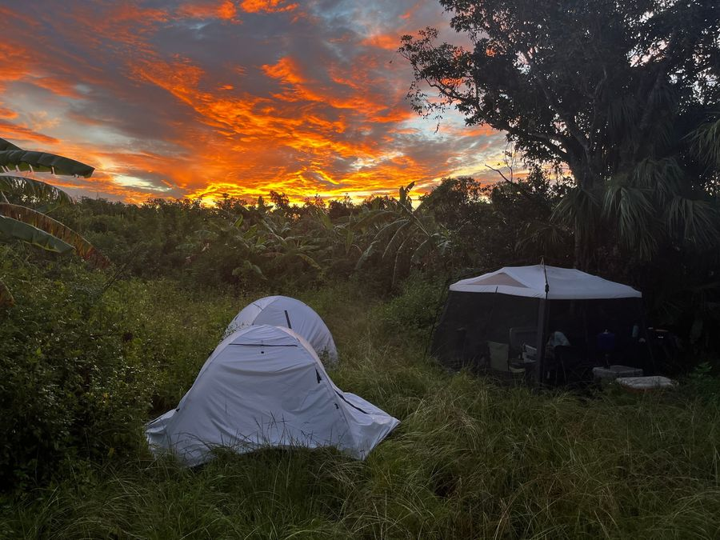
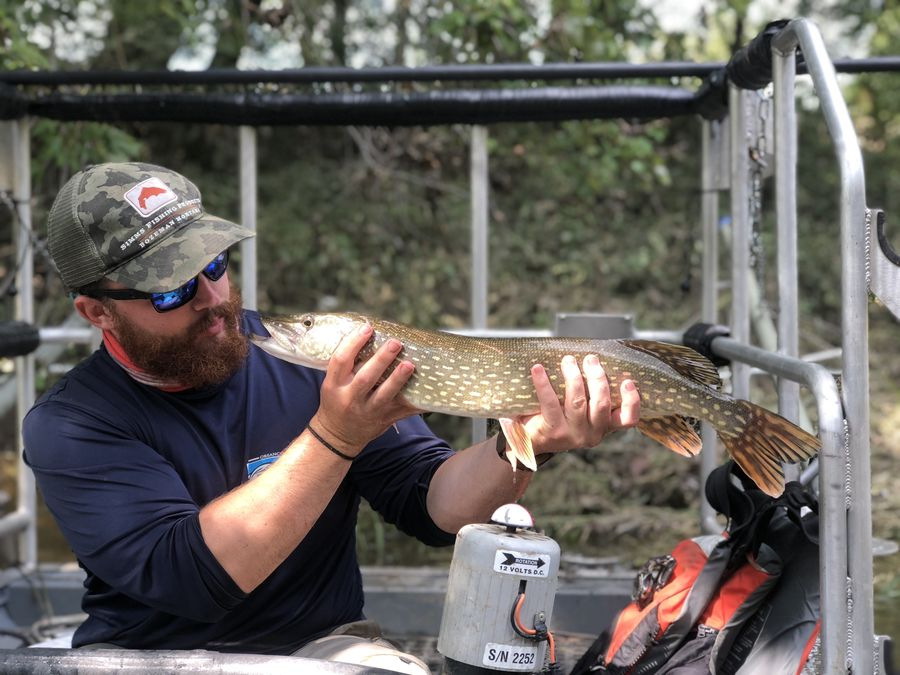
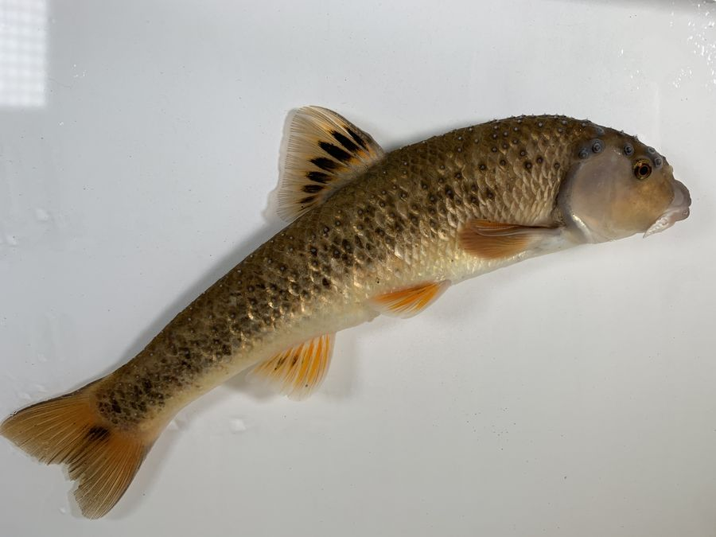
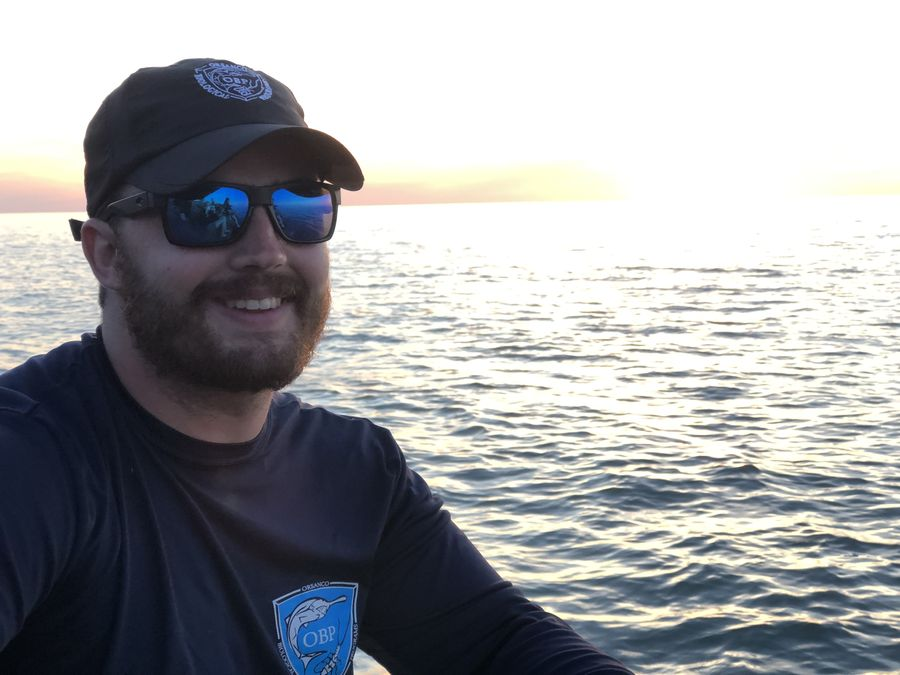
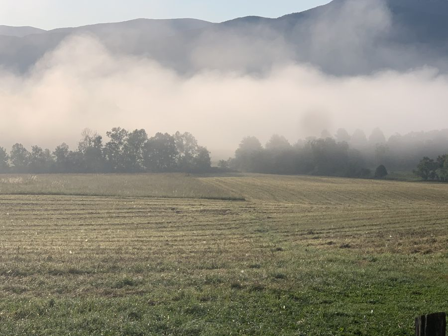

```{=html}
<script>document.body.classList.add('mw-home');</script>

<!-- ============ HERO: drone video ============ -->
<!-- Hero video: media/smallmouth-buffalo-drone.mp4 (32 s loop from the April 2019 drone flight).
     The poster is its first frame, shown while the video loads.
 -->
<header class="mw-hero">
  <video class="mw-hero-video" autoplay muted loop playsinline preload="metadata"
         poster="media/smallmouth-buffalo-poster.jpg" aria-hidden="true">
    <source src="media/smallmouth-buffalo-drone.mp4" type="video/mp4">
  </video>
  <div class="mw-hero-shade"></div>
  <div class="mw-hero-text">
    <h1 class="mw-name">Mack<br>White</h1>
    <p class="mw-role">Aquatic ecologist. Postdoctoral Research Scientist at The Ohio State University.</p>
    <nav class="mw-hero-links" aria-label="Quick links">
      <a href="Research.html">Research</a>
      <a href="CV.html">CV</a>
      <a href="mailto:mackwhiteecology@gmail.com">Email me</a>
    </nav>
  </div>
  <div class="mw-hero-foot">
    <p class="mw-hero-caption">Smallmouth Buffalo spawning migration in Citico Creek. Drone footage by Mack White.</p>
    <button class="mw-video-toggle" type="button" aria-pressed="false">Pause video</button>
  </div>
</header>

<!-- ============ INTRO ============ -->
<section class="mw-intro">
  <p class="mw-lede">How does global change alter the roles animals play in ecosystems? My research tackles this question across levels of biological organization, from individuals to ecosystems.</p>
  <div class="mw-intro-side">
    
    <p>I work with Dr. Casey Pennock in the Aquatic Conservation &amp; Ecology Lab at Ohio State, mostly in rivers of the Colorado River basin. Before that I earned my Ph.D. at Florida International University working in Everglades National Park.</p>
    <p class="mw-links">
      <a href="https://scholar.google.com/citations?user=hLHcmSYAAAAJ&amp;hl=en&amp;oi=sra">Google Scholar</a>
      <a href="https://github.com/mackwhite">GitHub</a>
      <a href="https://bsky.app/profile/mackeco.bsky.social">Bluesky</a>
    </p>
  </div>
</section>

<!-- ============ FULL-BLEED PHOTO ============ -->
<figure class="mw-band">
  
</figure>

<!-- ============ RESEARCH THEMES ============ -->
<section class="mw-research" aria-labelledby="research-h">
  <h2 id="research-h" class="mw-h2">What I work on</h2>
  <div class="mw-themes">
    <article class="mw-theme">
      
      <h3>Animal movement</h3>
      <p>I use a variety of techniques to understand the ecological causes and consequences of animal movement, from Common Snook in the Gulf of Mexico to suckers in Appalachian streams.</p>
    </article>
    <article class="mw-theme">
      
      <h3>Nutrients and food webs</h3>
      <p>From lakes to rivers and rivers to coral reefs, animals link seemingly disparate ecosystems by recycling nutrients and moving energy.</p>
    </article>
    <article class="mw-theme">
      
      <h3>Rivers under global change</h3>
      <p>How flow loss, warming, and invasive species reshape native fish and aquatic insect communities in dryland rivers of the Colorado River basin.</p>
    </article>
  </div>
  <p class="mw-more"><a href="CV.html#publications">See publications</a></p>
</section>

<!-- ============ FIELD GALLERY ============ -->
<!-- Edit captions in the data-caption attributes. g-wide = big, g-tall = portrait, g-std = small -->
<section class="mw-gallery-wrap" aria-labelledby="field-h">
  <h2 id="field-h" class="mw-h2 mw-pad">From the field</h2>
  <div class="mw-gallery">
    <button class="g-wide" data-full="images/web/ttu-transect.jpg" data-caption="Measuring a stream transect during M.S. fieldwork in Tennessee"></button>
    <button class="g-tall" data-full="images/web/fiu-boat-wake.jpg" data-caption="Running the boat across open water, South Florida"></button>
    <button class="g-std" data-full="images/web/ors-flathead.jpg" data-caption="A big catfish on the Ohio River survey boat"></button>
    <button class="g-tall" data-full="images/web/fiu-cowfish.jpg" data-caption="A juvenile cowfish from the seagrass"></button>
    <button class="g-wide" data-full="images/web/fiu-camp-sunset.jpg" data-caption="Sunset over field camp, South Florida"></button>
    <button class="g-tall" data-full="images/web/ttu-sucker-bank.jpg" data-caption="A spawning sucker, Tennessee"></button>
    <button class="g-std" data-full="images/web/ors-pike.jpg" data-caption="A pike from ORSANCO surveys in the Ohio River basin"></button>
    <button class="g-std" data-full="images/web/fiu-red-hats.jpg" data-caption="The FIU field crew at dawn"></button>
    <button class="g-wide" data-full="images/web/fiu-release.jpg" data-caption="Releasing a fish at sunset, South Florida"></button>
    <button class="g-std" data-full="images/web/ors-backpack.jpg" data-caption="Backpack electrofishing a headwater stream"></button>
    <button class="g-tall" data-full="images/web/fiu-blue-crab.jpg" data-caption="A Blue Crab"></button>
    <button class="g-tall" data-full="images/web/ttu-larvae.jpg" data-caption="Larval fish under the microscope"></button>
    <button class="g-std" data-full="images/web/ors-gar-night.jpg" data-caption="A gar from a night electrofishing run"></button>
    <button class="g-wide" data-full="images/web/fiu-crocodile.jpg" data-caption="An American Crocodile with a meal at the boat ramp"></button>
    <button class="g-std" data-full="images/web/ttu-redhorse-studio.jpg" data-caption="Specimen photo from the Tennessee Tech lab"></button>
    <button class="g-std" data-full="images/web/fiu-snook-workup.jpg" data-caption="Working up a Common Snook on the electrofishing boat"></button>
    <button class="g-std" data-full="images/web/ttu-crew.jpg" data-caption="The Tennessee Tech stream fish crew"></button>
    <button class="g-wide" data-full="images/web/ors-sunset.jpg" data-caption="End of a long day on the water"></button>
    <button class="g-tall" data-full="images/web/fiu-lily-sampling.jpg" data-caption="Collecting samples among the lily pads"></button>
    <button class="g-std" data-full="images/web/tu-saw-crew.jpg" data-caption="Stream restoration crew, Monongahela National Forest, 2017"></button>
    <button class="g-std" data-full="images/web/fiu-shark.jpg" data-caption="A Bull Shark"></button>
    <button class="g-wide" data-full="images/web/fiu-seine.jpg" data-caption="Hauling a seine net across the flats"></button>
    <button class="g-std" data-full="images/web/ttu-fog.jpg" data-caption="Morning fog before sampling, Tennessee"></button>
    <button class="g-std" data-full="images/web/ors-boat.jpg" data-caption="Running the boat on the Ohio River"></button>
    <button class="g-std" data-full="images/web/fiu-camp-night.jpg" data-caption="Field camp at night"></button>
    <button class="g-wide" data-full="images/web/fiu-snook-release2.jpg" data-caption="Releasing a Common Snook"></button>
    <button class="g-std" data-full="images/web/ttu-sucker-smile.jpg" data-caption="Spring sucker run, Tennessee"></button>
    <button class="g-std" data-full="images/web/ors-forest-crew.jpg" data-caption="Survey crew on a forest stream"></button>
    <button class="g-std" data-full="images/web/ttu-overlook.jpg" data-caption="Looking out over the Tennessee hills"></button>
  </div>
</section>

<dialog class="mw-lightbox" aria-label="Photo viewer">
  
  <p class="mw-lb-caption"></p>
  <button class="mw-lb-close" type="button">Close</button>
  <button class="mw-lb-prev" type="button" aria-label="Previous photo">&#8249;</button>
  <button class="mw-lb-next" type="button" aria-label="Next photo">&#8250;</button>
</dialog>

<!-- ============ PATH ============ -->
<section class="mw-path" aria-labelledby="path-h">
  <h2 id="path-h" class="mw-h2">How I got here</h2>
  <ol>
    <li><span class="yr">2025 to now</span><span><strong>The Ohio State University</strong>, Postdoctoral Research Scientist</span></li>
    <li><span class="yr">2021 to 2025</span><span><strong>Florida International University</strong>, Ph.D.</span></li>
    <li><span class="yr">2019 to 2021</span><span><strong>Tennessee Technological University</strong>, M.S.</span></li>
    <li><span class="yr">2018</span><span><strong>ORSANCO</strong>, Contractual Biologist</span></li>
    <li><span class="yr">2017</span><span><strong>Trout Unlimited &amp; US Forest Service</strong>, Watershed Restoration Technician</span></li>
    <li><span class="yr">2013 to 2017</span><span><strong>Marshall University</strong>, B.S.</span></li>
  </ol>
</section>

<!-- ============ CONTACT ============ -->
<section class="mw-contact">
  <p>Want to collaborate or have questions?</p>
  <a class="mw-contact-mail" href="mailto:mackwhiteecology@gmail.com">mackwhiteecology@gmail.com</a>
</section>

<script>
(function () {
  // Hero video: pause control, and respect reduced-motion settings
  var v = document.querySelector('.mw-hero-video');
  var btn = document.querySelector('.mw-video-toggle');
  function setPlaying(on) {
    if (on) { v.play().catch(function(){}); } else { v.pause(); }
    btn.textContent = on ? 'Pause video' : 'Play video';
    btn.setAttribute('aria-pressed', on ? 'false' : 'true');
  }
  if (window.matchMedia('(prefers-reduced-motion: reduce)').matches) { v.removeAttribute('autoplay'); setPlaying(false); }
  btn.addEventListener('click', function () { setPlaying(v.paused); });
  // Hide the toggle if the video file isn't there yet
  var foot = document.querySelector('.mw-hero-foot');
  var src = v.querySelector('source');
  if (src) src.addEventListener('error', function () { foot.hidden = true; });

  // Navbar goes solid once you scroll past the hero
  var hero = document.querySelector('.mw-hero');
  function onScroll() { document.body.classList.toggle('mw-scrolled', window.scrollY > hero.offsetHeight - 80); }
  window.addEventListener('scroll', onScroll, { passive: true }); onScroll();

  // Lightbox
  var items = Array.prototype.slice.call(document.querySelectorAll('.mw-gallery button'));
  var dlg = document.querySelector('.mw-lightbox');
  var img = dlg.querySelector('img'), cap = dlg.querySelector('.mw-lb-caption');
  var idx = 0;
  function show(i) {
    idx = (i + items.length) % items.length;
    var b = items[idx];
    img.src = b.dataset.full; img.alt = b.querySelector('img').alt; cap.textContent = b.dataset.caption || '';
  }
  items.forEach(function (b, i) { b.addEventListener('click', function () { show(i); dlg.showModal(); }); });
  dlg.querySelector('.mw-lb-close').addEventListener('click', function () { dlg.close(); });
  dlg.querySelector('.mw-lb-prev').addEventListener('click', function () { show(idx - 1); });
  dlg.querySelector('.mw-lb-next').addEventListener('click', function () { show(idx + 1); });
  dlg.addEventListener('click', function (e) { if (e.target === dlg) dlg.close(); });
  dlg.addEventListener('keydown', function (e) {
    if (e.key === 'ArrowLeft') show(idx - 1);
    if (e.key === 'ArrowRight') show(idx + 1);
  });
})();
</script>
```
